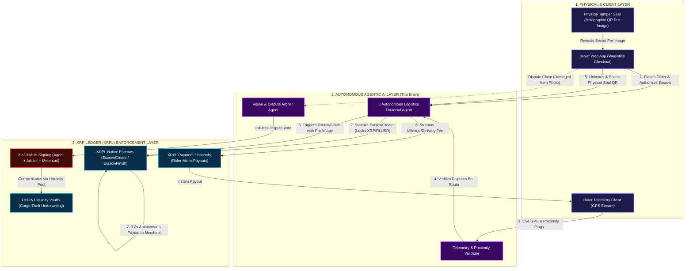

# Wegistics (Telxi Ecosystem)

> **Trustless Physical Handover, Autonomous Agentic Finance & DePIN Underwriting on the XRP Ledger**

[-008CEE?logo=ripple&logoColor=white)](https://xrpl.org)
[](https://xrpl.org)
[](#-depin-liquidity-underwriting-vaults)
[](./Styleguide.md)

---

## 📖 Executive Summary & Problem Statement

In emerging African commerce hubs (Nigeria, Kenya, Ghana, South Africa), **over 70% of e-commerce transactions rely on "Pay on Delivery" (PoD)**. 

This model creates a multi-billion dollar trust impasse:
1. **The Merchant Dilemma:** Social commerce vendors (WhatsApp, Instagram, TikTok) lose millions to dispatch rider theft, package swaps (empty box scams), and customers canceling orders while couriers are in transit.
2. **The Buyer Dilemma:** Buyers refuse upfront electronic bank transfers due to rampant online fraud and non-delivery of purchased goods.
3. **The Logistics Dilemma:** Dispatch riders and informal courier fleets lack formal credit lines and capital to insure goods in transit, leading to daily cash-handling fraud and disputes.

**Wegistics** solves this crisis by combining **Autonomous Agentic Finance**, **physical cryptographic tamper seals**, and **native XRP Ledger (XRPL) Escrows** to guarantee safe physical handovers with zero counterparty risk.

---

## 🏛️ System Architecture

Wegistics is engineered across three clean, decoupled tiers:



---

## ⚡ The 4 Core User Journeys

### 1. 🛍️ The Merchant
* **Zero-Friction Link Creation:** In 15 seconds, create an escrow payment link directly inside Instagram DMs or WhatsApp.
* **Physical Seal Linking:** Attach a serialized, destructible tamper-evident security tape over the box seam. The AI agent generates a SHA-256 hash condition from this seal.
* **Zero-Theft Guarantee:** Hand the package to dispatch couriers knowing the parcel is collateralized 100% by DePIN liquidity vaults.
* **Instant Settlement:** Funds land directly in the merchant's XRPL wallet within 3–5 seconds of delivery.

### 2. 📦 The Buyer
* **No Crypto Jargon:** Pay using local currency or XRP/RLUSD. Funds are locked into a trustless escrow rather than sent to the seller.
* **Real-time Live Handover Tracking:** Monitor the courier's verified GPS proximity.
* **Inspect, Unbox & Scan:** When the rider arrives, verify that the physical tape is unbroken, unbox the item, and scan the internal QR code.
* **Cryptographic Release:** Scanning reveals the secret pre-image, automatically unlocking the XRPL escrow to pay the vendor.

### 3. 🚚 The Logistics Fleet Operator
* **Revolving Collateral Float:** Stake capital (e.g. 5,000 XRP) into the Tier-1 Underwriting Pool to back your couriers.
* **High Capital Velocity:** As soon as package A is scanned, its collateral is immediately released to back package B. Capital compounds 4 to 6 times daily.
* **Automated Rider Streaming:** Delivery fees stream automatically to couriers via XRPL Payment Channels upon verified delivery.

### 4. 📈 The Investor (DePIN RWA Yield)
* **Senior Tranche Protection:** Logistics fleet companies provide a 20%–30% First-Loss buffer, shielding investor principal from theft.
* **Continuous Escrow Protocol Yield:** Earn 18.4% – 21.2% projected APY funded by micro-transaction take-rates (0.75% per scan).
* **Vetted Fleet Allocation:** Selectively deploy capital into verified fleets in Lagos, Nairobi, or Accra based on real on-chain track records.

---

## 🛡️ Edge Cases & Threat Modeling

| Attack Vector | Vulnerability in Traditional PoD | How Wegistics Solves It |
| :--- | :--- | :--- |
| **Buyer Extortion** | Buyer takes the package inside and refuses to hand over cash or confirm payment. | **GPS Telemetry & Auto Time-Locks:** When the rider reaches within 20m of destination, an auto-release countdown begins. If no dispute is raised, funds stream to vendor automatically. |
| **Rider Theft / Package Swap** | Rider carefully slices the tape, takes the sneakers/phone, replaces with a brick. | **Destructible Holographic Seals:** Tape shatters upon tampering, rendering the embedded QR code permanently un-scannable. The buyer refuses the broken parcel. |
| **Factory Defect Dispute** | Item is damaged or wrong upon opening despite intact packaging. | **AI Vision Arbiter & 2-of-3 Multi-Sig:** Buyer uploads unboxing proof; the AI Arbiter coordinates with human arbiters to freeze or refund escrow. |
| **Rider Vanishing with Cargo** | Vendor suffers a 100% financial write-off. | **DePIN Liquidity Vaults:** The fleet's First-Loss vault immediately reimburses the merchant on-chain. |

---

## 🛠️ Technology Stack & Ledger Primitives

* **Frontend:** React 19, Vite, Tailwind CSS, Lucide Icons, HTML5-QRCode.
* **Design Standard:** Strictly complies with the [Telxi Brand Style Guide](./Styleguide.md) (Mathematical 8-point spatial rhythm, `#7006B7` Brand Primary, `#8F0CD1` Brand Highlight, `#F3E8FF` Subtle Tint).
* **Blockchain Core:** XRP Ledger (`xrpl.js` v3.x) over Secure WebSockets (`wss://s.altnet.rippletest.net:51233`).
* **XRPL Primitives Used:**
  * `EscrowCreate`: Locks buyer funds on-chain with SHA-256 Crypto-Conditions.
  * `EscrowFinish`: Releases payment instantly when the physical pre-image is supplied upon scan.
  * `PaymentChannels`: Real-time streaming micro-payouts to couriers.
  * `SignerListSet`: 2-of-3 Multi-Signature governance for dispute freezes.

---

## 🚀 Local Development Setup

### Prerequisites
* **Node.js**: v18.0.0 or higher
* **npm**: v9.0.0 or higher

### Quickstart
```bash
# 1. Clone the repository
git clone https://github.com/<your-username>/wegistics.git
cd wegistics/web

# 2. Install dependencies
npm install

# 3. Start local development server
npm run dev
```

Visit `http://localhost:5174` in your browser.

---

## 🌐 Free Azure Cloud Deployment

Wegistics is optimized for zero-cost deployment via **Azure Static Web Apps**:

1. Fork/Push this repository to GitHub.
2. In the **Azure Portal**, create a new **Static Web App** (Free Tier).
3. Connect your GitHub repository:
   * **App location:** `/web`
   * **Output location:** `dist`
4. Add a Custom Domain pointing to `wegistics.telxi-app.com.ng` via CNAME record.

---

## 📄 License & Attribution

Built for the **Ripple Agentic Finance Track** & **DePIN Track**.
Designed under the **Telxi Ecosystem Design System**.
Licensed under the [MIT License](LICENSE).
